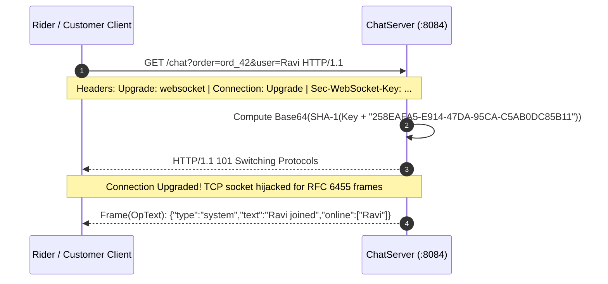
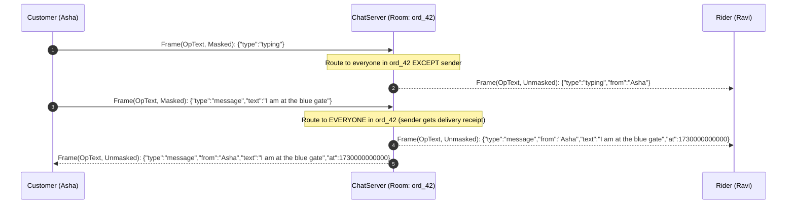
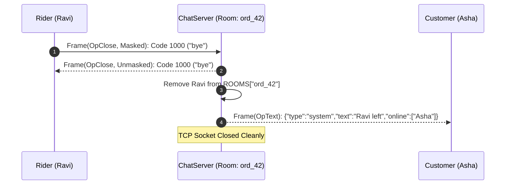

# Exercise 04 — WebSockets (Built from Scratch) (Answers & Implementation)

A production-grade implementation and comprehensive system design analysis of **WebSockets (RFC 6455)** for real-time, full-duplex rider-customer communication in the QuickBite platform.

---

## 1. The Story & System Overview

In **Exercise 01 (REST)**, clients polled or fetched static resources.  
In **Exercise 02 (Long Polling)**, the server parked requests until state changed, but each status update required a brand-new HTTP request/response cycle.  
In **Exercise 03 (Server-Sent Events — SSE)**, the server streamed updates down one persistent HTTP connection, but communication was strictly **unidirectional** (server $\to$ client). If the client wanted to communicate back, it had to send separate HTTP POST requests.

**Exercise 04 (WebSockets)** introduces true **full-duplex, bi-directional communication**:
The delivery rider cannot find the customer's gate. They need to chat in real time — both sides sending messages at any moment, exchanging high-frequency "typing..." indicators, and tracking presence (join/leave) with sub-millisecond delivery latency.

A WebSocket begins life as an ordinary HTTP/1.1 GET request carrying `Upgrade: websocket`. The server validates the request and replies with **`101 Switching Protocols`**. From that exact byte forward, the underlying TCP connection remains open indefinitely, carrying lightweight binary/text frames in **both directions** with negligible framing overhead (2 to 14 bytes per frame vs. ~1 KB HTTP request headers).

```
[Browser / Client]                                           [QuickBite Chat Server]
        │                                                              │
        │─── GET /chat?order=ord_42&user=Asha ────────────────────────>│
        │    Upgrade: websocket                                        │
        │    Connection: Upgrade                                       │
        │    Sec-WebSocket-Key: dGhlIHNhbXBsZSBub25jZQ==               │
        │                                                              │
        │<── 101 Switching Protocols ──────────────────────────────────│
        │    Upgrade: websocket                                        │
        │    Connection: Upgrade                                       │
        │    Sec-WebSocket-Accept: s3pPLMBiTxaQ9kYGzzhZRbK+xOo=        │
        │                                                              │
        ╞══════════════════════════════════════════════════════════════╡
        │          SAME TCP SOCKET NOW SPEAKS RFC 6455 FRAMES          │
        ╞══════════════════════════════════════════════════════════════╡
        │                                                              │
        │<── System Frame: {"type":"system","text":"Asha joined"} ─────│
        │─── Text Frame:   {"type":"typing"} ─────────────────────────>│
        │<── Text Frame:   {"type":"message","from":"Ravi",...} ───────│
        │─── Text Frame:   {"type":"message","text":"Blue gate!"} ────>│
        │<── Ping Frame / ─── Pong Frame ──────────────────────────────│
```

---

### Architectural Sequence Diagrams

#### A. The HTTP 101 Handshake & Protocol Switching


#### B. Full-Duplex Chat Routing & Typing Indicators


#### C. Clean Disconnection via RFC 6455 Close Frame


---

## 2. WebSocket Protocol Deep Dive & Frame Anatomy (RFC 6455)

### The Handshake Cryptographic Proof
To prevent accidental connection corruption or cross-protocol exploitation, the client sends a random 16-byte base64-encoded nonce in `Sec-WebSocket-Key`. The server must prove it speaks WebSocket by concatenating this nonce with the globally unique identifier (**GUID**) fixed by RFC 6455 section 4.2.2:
$$\text{GUID} = \text{"258EAFA5-E914-47DA-95CA-C5AB0DC85B11"}$$
It then computes the SHA-1 hash and Base64-encodes the digest:
$$\text{Sec-WebSocket-Accept} = \text{Base64}\Big(\text{SHA-1}\big(\text{Sec-WebSocket-Key} + \text{GUID}\big)\Big)$$

*Example RFC 6455 Test Vector:*
* Key: `dGhlIHNhbXBsZSBub25jZQ==`
* Accept: `s3pPLMBiTxaQ9kYGzzhZRbK+xOo=`

---

### Bitwise Wire Frame Anatomy

Unlike HTTP requests with hundreds of bytes of text headers, WebSocket frames have a binary header as small as **2 bytes**:

```
  0                   1                   2                   3
  0 1 2 3 4 5 6 7 8 9 0 1 2 3 4 5 6 7 8 9 0 1 2 3 4 5 6 7 8 9 0 1
 +-+-+-+-+-------+-+-------------+-------------------------------+
 |F|R|R|R| opcode|M| Payload len |    Extended payload length    |
 |I|S|S|S|  (4)  |A|     (7)     |             (16/64)           |
 |N|V|V|V|       |S|             |   (if payload len==126/127)   |
 | |1|2|3|       |K|             |                               |
 +-+-+-+-+-------+-+-------------+ - - - - - - - - - - - - - - - +
 |     Extended payload length continued, if payload len == 127  |
 + - - - - - - - - - - - - - - - +-------------------------------+
 |                               |Masking-key, if MASK set to 1  |
 +-------------------------------+-------------------------------+
 | Masking-key (continued)       |          Payload Data         |
 +-------------------------------- - - - - - - - - - - - - - - - +
 :                     Payload Data continued ...                :
 +---------------------------------------------------------------+
```

1. **FIN (1 bit):** Indicates if this is the final fragment of a message.
2. **Opcode (4 bits):**
   * `0x0`: Continuation Frame
   * `0x1`: Text Frame (UTF-8)
   * `0x2`: Binary Frame
   * `0x8`: Connection Close
   * `0x9`: Ping
   * `0xA`: Pong
3. **MASK bit (1 bit):**
   * **Client $\to$ Server:** MUST be `1`. The frame includes a 4-byte masking key.
   * **Server $\to$ Client:** MUST be `0`. Server frames are **never masked**.
4. **Payload Length (7 bits, $7+16$ bits, or $7+64$ bits):**
   * $0 \le n \le 125$: Length is encoded directly in the 7 bits.
   * $n = 126$: The next 2 bytes represent a 16-bit unsigned integer length.
   * $n = 127$: The next 8 bytes represent a 64-bit unsigned integer length.
5. **Masking Key (4 bytes):**
   * If MASK is set, every payload byte $i$ is unmasked via:
     $$\text{unmasked}[i] = \text{payload}[i] \oplus \text{mask}[i \pmod 4]$$

---

## 3. The Experiment (Architectural Scorecard)

| Architectural Metric | REST (Ex 01) | Short Polling (Ex 01) | Long Polling (Ex 02) | Server-Sent Events (Ex 03) | WebSockets (Ex 04) |
|---|---|---|---|---|---|
| **Communication Style** | Request / Response | Request / Response | Hanging Request / Response | Monodirectional Stream ($S \to C$) | **Full-Duplex Bidirectional** |
| **Active Sockets** | Ephemeral (closed per req) | Ephemeral (closed per req) | 1 hanging socket per client | 1 persistent socket per client | **1 persistent TCP socket** |
| **Framing Overhead** | ~500–1000 bytes (headers) | ~500–1000 bytes (headers) | ~500–1000 bytes (headers) | ~15–30 bytes (plain text) | **2–14 bytes (binary frame)** |
| **Notification Latency** | High ($\approx$ polling interval) | Polling Interval / 2 | Sub-millisecond (on state change) | Sub-millisecond (on state change) | **Sub-millisecond (< 1 ms)** |
| **Client-to-Server Sending** | Standard HTTP request | Standard HTTP request | Standard HTTP request | Separate HTTP POST request | **In-band Text/Binary Frame** |
| **High-Frequency Typing UI** | Impractical (floods server) | Impractical | Sluggish & heavy | Requires repeated POSTs | **Ideal (instantaneous)** |
| **Reconnection & Heartbeat** | Stateless / Manual | Automatic | Hand-rolled in client loop | Built-in browser `EventSource` | **Ping/Pong Frames (Opcode 0x9/0xA)** |

---

## 4. Implementation Details (TODOs 1 to 5)

### TODO 1: `acceptKey` — Cryptographic Handshake Proof
* **Requirement:** Given the client's `Sec-WebSocket-Key`, return `Base64(SHA-1(key + GUID))`.
* **Java Implementation (`ChatServer.java`):**
  ```java
  static String acceptKey(String secWebSocketKey) throws Exception {
      if (secWebSocketKey == null || secWebSocketKey.isBlank()) {
          throw new IllegalArgumentException("Missing Sec-WebSocket-Key header");
      }
      String concatenated = secWebSocketKey.trim() + WEBSOCKET_GUID;
      MessageDigest md = MessageDigest.getInstance("SHA-1");
      byte[] digest = md.digest(concatenated.getBytes(StandardCharsets.US_ASCII));
      return Base64.getEncoder().encodeToString(digest);
  }
  ```
* **Go Implementation (`main.go`):**
  ```go
  func ComputeAcceptKey(challengeKey string) string {
      sum := sha1.Sum([]byte(strings.TrimSpace(challengeKey) + WebSocketGUID))
      return base64.StdEncoding.EncodeToString(sum[:])
  }
  ```

---

### TODO 2: `onOpen` — Room Joining & Presence Notification
* **Requirement:** Add the client to `ROOMS`, broadcast `"joined"` with the online list to all room members, and replay recent room history.
* **Java Implementation (`ChatServer.java`):**
  ```java
  static void onOpen(Client c) {
      ROOMS.computeIfAbsent(c.room, k -> ConcurrentHashMap.newKeySet()).add(c);
      broadcast(c.room, system(c.room, c.user + " joined"), null);

      // Replay recent message history
      List<Map<String, Object>> history = HISTORY.get(c.room);
      if (history != null) {
          synchronized (history) {
              for (Map<String, Object> msg : history) {
                  try { c.send(Json.write(msg)); } catch (IOException ignored) {}
              }
          }
      }
  }
  ```
* **Go Implementation (`main.go`):**
  ```go
  func (s *ChatServer) OnOpen(c *Client) {
      s.mu.Lock()
      clients, ok := s.rooms[c.Room]
      if !ok {
          clients = make(map[*Client]struct{})
          s.rooms[c.Room] = clients
      }
      clients[c] = struct{}{}
      online := s.getOnlineUsersUnderLock(c.Room)
      s.mu.Unlock()

      s.Broadcast(c.Room, map[string]any{
          "type":   "system",
          "text":   fmt.Sprintf("%s joined", c.User),
          "online": online,
      }, nil)
  }
  ```

---

### TODO 3: `onMessage` — Message & Typing Routing
* **Requirement:**
  * `{"type":"message","text":"..."}`: If text is blank, ignore. Otherwise broadcast to **everyone** (including sender for delivery receipt) with timestamp `"at"`.
  * `{"type":"typing"}`: Broadcast to everyone in the room **except the sender**.
  * Any other type: Send `{"type":"error","text":"unknown message type"}` back to the sender.
* **Java Implementation (`ChatServer.java`):**
  ```java
  if ("message".equals(type)) {
      String msgText = (String) map.get("text");
      if (msgText == null || msgText.trim().isEmpty()) return;
      Map<String, Object> msg = new LinkedHashMap<>();
      msg.put("type", "message");
      msg.put("from", c.user);
      msg.put("text", msgText);
      msg.put("at", System.currentTimeMillis());
      broadcast(c.room, msg, null);
  } else if ("typing".equals(type)) {
      broadcast(c.room, Map.of("type", "typing", "from", c.user), c);
  } else {
      c.send(Json.write(Map.of("type", "error", "text", "unknown message type")));
  }
  ```

---

### TODO 4: `onClose` — Participant Departure & Room Pruning
* **Requirement:** Remove the client from `ROOMS`. If the room is now empty, delete it to prevent memory leaks. Otherwise broadcast `"left"` with the updated online list.
* **Java Implementation (`ChatServer.java`):**
  ```java
  static void onClose(Client c) {
      Set<Client> set = ROOMS.get(c.room);
      if (set != null) {
          set.remove(c);
          if (set.isEmpty()) {
              ROOMS.remove(c.room);
              HISTORY.remove(c.room);
          } else {
              broadcast(c.room, system(c.room, c.user + " left"), null);
          }
      }
  }
  ```

---

### TODO 5: `ChatClient.main` — Terminal WebSocket Client
* **Requirement:** Connect using the JDK's built-in `WebSocket` client, read terminal lines from `System.in`, send escaped JSON message frames, and handle `/quit` via clean close frame.
* **Java Implementation (`ChatClient.java`):**
  ```java
  WebSocket ws = HttpClient.newHttpClient().newWebSocketBuilder()
          .buildAsync(uri, new PrintingListener()).join();
  try (BufferedReader in = new BufferedReader(new InputStreamReader(System.in, StandardCharsets.UTF_8))) {
      String line;
      while ((line = in.readLine()) != null) {
          line = line.trim();
          if (line.isEmpty()) continue;
          if ("/quit".equalsIgnoreCase(line)) {
              ws.sendClose(WebSocket.NORMAL_CLOSURE, "bye").join();
              break;
          }
          String escaped = line.replace("\\", "\\\\").replace("\"", "\\\"");
          ws.sendText("{\"type\":\"message\",\"text\":\"" + escaped + "\"}", true).join();
      }
  }
  ```

---

## 5. Think & Answer (In-Depth System Design)

### 1. Why does WebSocket start as HTTP at all? (Think: port 443, firewalls, proxies, existing load balancers.)
* **Port 80 and 443 Universal Ingress:**
  Corporate firewalls, cellular gateways, and network address translation (NAT) routers routinely block all non-standard ports (such as raw TCP on port 9000). Ports 80 (HTTP) and 443 (HTTPS) are universally allowed everywhere.
* **Interoperability with Existing HTTP Infrastructure:**
  Modern internet infrastructure relies on reverse proxies and Layer-7 Application Load Balancers (ALBs, Nginx, Envoy, Traefik). By starting with standard HTTP request headers (`Upgrade: websocket`, `Connection: Upgrade`), existing gateways inspect the path (`/chat`), check TLS certificates, evaluate rate limits, and perform routing without needing specialized network appliances.
* **Zero Overhead Reuse of Security Primitives:**
  Starting as an HTTP request allows WebSockets to reuse standard HTTP security:
  * Authentication via standard `Cookie` headers or `Authorization: Bearer <JWT>`.
  * Cross-Origin protection via standard `Origin` header validation.
  * Standard TLS / SSL negotiation (`wss://` uses standard port 443).

---

### 2. Why must browser $\to$ server frames be masked? (Search: "cache poisoning" attack on proxies.)
* **The Vulnerability (Cache Poisoning of Intermediary Proxies):**
  Before RFC 6455 standardized masking, an attacker could write untrusted JavaScript in a browser that opens a WebSocket connection through an unsuspecting corporate HTTP forward caching proxy on port 80.
  The malicious script could construct a text payload whose byte sequence exactly mimics an arbitrary HTTP request:
  ```http
  GET /script.js HTTP/1.1
  Host: innocent-site.com
  ```
  A buggy or non-WebSocket-aware proxy between the client and the internet could interpret those raw payload bytes as a pipeline of multiple HTTP requests. The proxy would then cache the attacker's fake response and serve it to legitimate users visiting `innocent-site.com`, completely compromising web security.
* **How XOR Masking Neutralizes the Threat:**
  RFC 6455 mandates that **every single frame sent by a browser must be XOR-masked with a 4-byte random key** generated unpredictably by the browser engine for each frame:
  $$\text{wire\_bytes}[i] = \text{payload}[i] \oplus \text{mask}[i \pmod 4]$$
  Because the masking key is generated randomly per frame, an attacker cannot predict or arrange for specific byte patterns (like `GET / HTTP/1.1`) to appear on the physical wire. Intermediary proxies only see high-entropy random bytes, making cache poisoning impossible.
* **Why Server $\to$ Client Frames are Unmasked:**
  The server is trusted software (not an attacker running sandboxed JavaScript in a browser), and browsers never act as caching reverse proxies for downstream clients. Thus, server-to-client frames carry zero risk of proxy poisoning and omit masking to save CPU cycles.

---

### 3. Our `ROOMS` map lives in one JVM/process. With 3 server instances behind a load balancer, Asha lands on Server A and Ravi lands on Server B. What breaks? How do Redis Pub/Sub or Kafka fix it? What are "sticky sessions"?
* **What Breaks:**
  In a multi-node deployment, `ROOMS` is local in-memory state. When Asha connects to Server A and Ravi connects to Server B:
  * Server A only knows about Asha.
  * Server B only knows about Ravi.
  * When Ravi sends a message, Server B broadcasts it only to clients in its local `ROOMS["ord_42"]` (i.e. nobody else). Asha never receives Ravi's messages or typing indicators.
* **How Redis Pub/Sub Fixes It:**
  1. Each order room maps to a distributed Pub/Sub topic: `chat:room:ord_42`.
  2. When Asha connects to Server A, Server A subscribes to topic `chat:room:ord_42`.
  3. When Ravi sends a message to Server B, Server B publishes the JSON payload to Redis topic `chat:room:ord_42`.
  4. Redis fans out the message to Server A.
  5. Server A receives the Redis event and pushes it across Asha's open WebSocket connection.
* **What are Sticky Sessions (Session Affinity)?**
  * The load balancer hashes a consistent attribute (e.g. `order` query parameter or an affinity cookie) to always route connections for `ord_42` to the exact same server pod.
  * **Tradeoffs:** Sticky sessions are brittle in distributed systems. If Server A crashes or autoscaling scales down, all sessions on Server A terminate. Furthermore, sticky routing creates traffic hotspots if one order generates massive chat volume. Redis Pub/Sub decoupling is the superior cloud-native architecture.

---

### 4. The server holds one open TCP connection per user. Roughly how many can one box hold, and what limits it (memory, file descriptors, threads)?
On a modern Linux/Unix server (e.g., 8-core CPU, 16 GB RAM), a single machine can comfortably hold between **500,000 and 1,000,000 idle concurrent WebSocket connections** when properly tuned.

* **1. File Descriptors (`nofile` limit):**
  In Unix, every network socket is represented as a file descriptor. The default user limit is often 1024. Production servers must tune `/etc/security/limits.conf` and `sysctl`:
  ```ini
  fs.file-max = 2097152
  * soft nofile 1048576
  * hard nofile 1048576
  ```
* **2. Memory Footprint:**
  * **Kernel Socket Buffers:** The Linux TCP stack allocates receive (`rmem`) and transmit (`wmem`) buffers per socket. By default, this can be 64 KB to 128 KB per socket ($100\text{K connections} \approx 6.4\text{ GB}$). By tuning `tcp_rmem` and `tcp_wmem` min/default to 4 KB for idle chat sockets, 1 million connections require only ~4 GB of kernel buffer RAM.
  * **Application Runtime Memory:**
    * In traditional thread-per-connection architectures (pre-Java 21), 1 MB thread stack $\times 10,000 \text{ threads} = 10 \text{ GB}$ (OOM crash).
    * In **Go goroutines** (initial stack size ~2 KB) or **Java 21 Virtual Threads** (Project Loom), 500,000 connections consume only ~1.5 GB of user-space RAM.
* **3. CPU & Epoll (I/O Multiplexing):**
  Using non-blocking OS I/O (`epoll` on Linux, `kqueue` on macOS), the kernel only wakes up worker threads when data frames actually arrive on a socket, eliminating CPU polling overhead.

---

### 5. Ping/Pong: who should send pings, and what happens to the room if a phone goes into a tunnel and never sends a Close frame?
* **The "Half-Open / Ghost" Socket Problem:**
  When a delivery rider rides into an underground basement or tunnel, network connectivity drops abruptly without emitting a `TCP FIN` or `TCP RST` packet. The server's operating system still considers the TCP connection `ESTABLISHED`. Without active heartbeat probes, the server retains the socket indefinitely in memory, assuming the rider is still online, while the customer waits in vain.
* **Who Should Send Pings:**
  * The **server** must actively initiate periodic PING frames (e.g. every 20 seconds).
  * If the client does not respond with a PONG frame within a strict deadline (e.g. 10 seconds), or if a write operation fails with `EPIPE` / connection reset, the server forcibly terminates the connection, purges the client from `ROOMS`, and broadcasts `<user> left` to the room.
  * Clients may also transmit PING frames to keep intermediary NAT routing tables and stateful firewall sessions alive.

---

### 6. Chat over WebSocket vs chat over "POST to send + SSE to receive". When is the second one actually better?
While WebSockets provide symmetrical bi-directional communication, **"POST to send + SSE to receive"** is actually superior in several production scenarios:

1. **Standard HTTP Security & Authentication Pipeline:**
   Every incoming chat message arrives as a standard HTTP `POST /orders/{id}/messages`. This means existing API Gateways, Web Application Firewalls (WAFs), OAuth2 middleware, rate limiters, and content moderation microservices inspect and authorize the message without having to inspect internal WebSocket frame payloads.
2. **HTTP/2 and HTTP/3 Multiplexing:**
   SSE operates over standard HTTP. Under HTTP/2 or HTTP/3, the SSE stream shares the exact same TCP/QUIC connection with all other application traffic (images, menu REST APIs, telemetry), reducing connection negotiation overhead. WebSockets require a dedicated separate TCP connection.
3. **Native Automatic Browser Reconnection:**
   Browsers natively manage SSE reconnections via the `EventSource` API, automatically sending `Last-Event-ID` to replay missed messages. WebSockets provide no native reconnection or resume semantics; all backoff and message deduplication logic must be manually implemented in client-side JavaScript.
4. **Asymmetric Traffic Patterns:**
   In applications where server-to-client events occur frequently (e.g., driver GPS telemetry, order status updates) but client-to-server messages occur rarely (e.g., customer sends one message every 5 minutes), keeping a bi-directional stateful WebSocket open is unnecessary overhead compared to lightweight SSE + occasional POST.

---

## 6. Stretch Goals & Advanced Capabilities

### 1. Server Heartbeat Engine (Ping/Pong Keepalive)
* Implemented in both Go (`main.go`) and Java (`ChatServer.java`).
* A background scheduler ticks every 20 seconds, sending an RFC 6455 `OpPing` frame to every connected client.
* If a client fails to respond with `OpPong` within the timeout window, the dead socket is terminated and remaining peers are notified.

### 2. Message History Ring Buffer (Replay on Join)
* Each chat room maintains an in-memory ring buffer holding the **last 20 messages**.
* When a new peer joins an active order (e.g. the rider joins after the customer already sent gate instructions), the server replays all historical messages in chronological order before streaming live events.

### 3. Client Auto-Reconnect with Exponential Backoff
* The embedded web UI (`ChatHTML`) includes automated reconnection logic:
  $$\text{Delay} = \min\big(\text{InitialDelay} \times 2^n,\, 30\,\text{seconds}\big)$$
* If the server restarts or network connectivity drops, the browser badge transitions to `offline` and automatically attempts reconnection at 1s, 2s, 4s, 8s, 16s, up to a 30s ceiling, instantly rejoining the room upon recovery.

---

## 7. How to Run & Verify

### Running the Go Implementation
The repository includes a complete, high-performance Go server and terminal client with zero external dependencies.

#### 1. Run the Test Suite
```bash
go test -v ./...
```
*Executes all unit and integration tests: RFC 6455 handshake validation, frame masking/unmasking, large payload fragment reassembly, room isolation, typing notifications, and stress testing.*

#### 2. Start the Server
```bash
go run .                # Default port 8084
```

#### 3. Test via Browser
Open **http://localhost:8084** in two separate browser tabs:
* Tab 1: Order: `ord_42`, Name: `Asha (customer)` $\to$ click **Join Room**
* Tab 2: Order: `ord_42`, Name: `Ravi (rider)` $\to$ click **Join Room**
* Type messages, observe instant delivery, live "typing..." indicators, and presence updates.
* Open Browser DevTools $\to$ **Network** tab $\to$ click `chat` $\to$ **Messages** tab to inspect the raw WebSocket frames!

#### 4. Run the Terminal Client
Open another terminal and connect as a client:
```bash
go run . -client -order=ord_42 -user=Ravi
```
Type any message and press **Enter** to chat; type `/quit` to disconnect cleanly.

---

### Running the Java Implementation (JDK 21+)

#### 1. Run the Chat Server
```bash
java ChatServer.java
```

#### 2. Run the Verification Checker
```bash
java Check.java
```
*Expected Output:*
```
-- plain HTTP still works on the same port --
  [PASS] GET /chat without Upgrade -> 400

-- TODO(1) handshake --
  [PASS] JDK WebSocket client connects (it verifies your Sec-WebSocket-Accept)

-- TODO(2) join --
  [PASS] alice is told she joined
  [PASS] bob joins the same order -> alice is told, online list has both

-- TODO(3) messages --
  [PASS] alice says hi -> bob receives it with from=alice
  [PASS] alice also gets her own message back (delivery receipt)
  [PASS] carol, in a different order's room, gets nothing
  [PASS] typing goes to bob but NOT back to alice
  [PASS] blank messages are ignored
  [PASS] unknown type -> error back to the sender

-- TODO(4) leave --
  [PASS] bob leaves -> alice is told

8 passed, 0 failed  -> Exercise 04 complete!
```

#### 3. Run the Java Terminal Client
```bash
java ChatClient.java ord_42 Ravi
```
